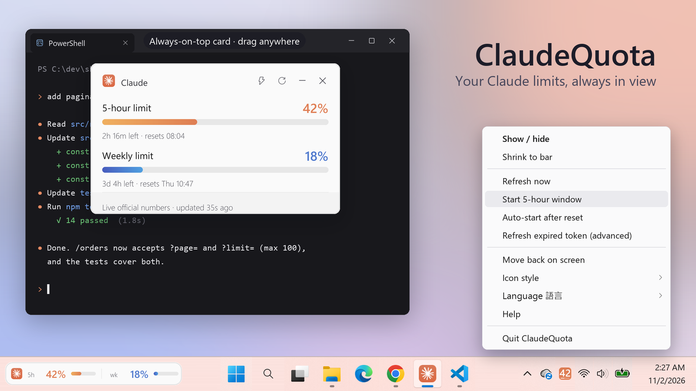
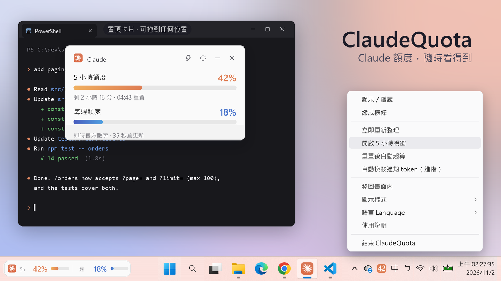

# ClaudeQuota

[](https://github.com/mintguesss/ClaudeQuota/actions/workflows/ci.yml)
[](https://github.com/mintguesss/ClaudeQuota/releases/latest)
[](LICENSE)


**See your Claude subscription's 5-hour and weekly limits at a glance, without opening anything.**

A small Windows tray app for Claude Pro / Max users. It shows the official usage numbers and when the 5-hour window resets, so you stop getting surprised by "you've hit your limit" in the middle of a task.

[中文說明](#中文說明)



## Features

- **Tray icon** with the percentage used; hover for a summary
- **Floating card** with both limits, progress bars and the exact reset time; drag it anywhere
- **Mini bar** that sits next to the taskbar, or hide everything and keep only the tray icon
- Stays put through Win+D and virtual desktop switches, and **gets out of the way of full-screen games and videos**
- **Official numbers only**: read from Anthropic's usage endpoint about every 2 minutes, falling back to the Claude desktop app's local cache. If neither is available it says so instead of guessing
- English and Chinese interface, following your Windows language (switchable in the tray menu)

## Download

Grab **`ClaudeQuota.exe`** from the [latest release](https://github.com/mintguesss/ClaudeQuota/releases/latest) and run it. No Python needed.

- The exe is built by GitHub Actions from this repository's source; a SHA-256 checksum is attached to each release.
- It is not code-signed, so Windows SmartScreen may warn on first run: **More info → Run anyway**.
- To start with Windows: press `Win + R`, type `shell:startup`, and put a shortcut to `ClaudeQuota.exe` in that folder.

**Requirements:** Windows 10 or 11, and [Claude Code](https://claude.com/claude-code) signed in at least once (that is where the usage token comes from). The Claude desktop app is optional and acts as a fallback.

### Run from source

```bash
git clone https://github.com/mintguesss/ClaudeQuota.git
cd ClaudeQuota
pip install pystray pillow
pythonw widget.py
```

`啟動.vbs` (double-click) does the same without a console window.

## Using it

Left-click the tray icon to show or hide the card; right-click for the menu. The ✕ on the card only hides it; quit from the tray menu. **Help** in the tray menu explains every button and menu item in the app itself.

| Card button | What it does |
| --- | --- |
| ⚡ | Start the 5-hour window now (sends one tiny Claude Code request) |
| ↻ | Re-read the numbers (the endpoint is rate-limited, about once every 2 minutes) |
| ─ | Shrink to the mini bar |
| ✕ | Hide (keeps running in the tray) |

### Two opt-in settings

Both are **off by default** because they spend quota or touch your Claude Code login. Turn them on in the tray menu if the trade-off suits you; the app shows the same pros and cons and asks before turning either one on.

**Auto-start after reset**: when no 5-hour window is running, run `claude -p hi` so a new window starts right away.

| Pros | Cons |
| --- | --- |
| The 5-hour clock starts as soon as the previous one ends, so it resets earlier in your day | Spends a small amount of quota each time, even if you were not going to use Claude |
| No need to remember to "kick off" the window | A window started while you are away may run out unused |

**Refresh expired token (advanced)**: when Claude Code's access token has expired (for example you only use the desktop app and never open the CLI), get a new one with the refresh token and save it back to `~/.claude/.credentials.json`.

| Pros | Cons |
| --- | --- |
| Live numbers keep working even when Claude Code has not run for a while | Refreshing rotates the refresh token. If Claude Code is running at that moment with the old one in memory, it may ask you to sign in again |
| Without it, you fall back to the desktop app's cache, which can be up to 5 minutes old | It uses Claude Code's own OAuth client. That interface is undocumented and not offered for third-party apps, so it may stop working or change at any time |

With this off, an expired token simply means the card shows the desktop cache (or "No usage data") until you open Claude Code once.

## Data and privacy

- **Claude Code:** reads the OAuth token from `~/.claude/.credentials.json` to ask for *your own* account's usage. It also reads timestamps (not content) from Claude Code's session logs to work out when the window started. With *Refresh expired token* on, it also writes the renewed token back to the same file.
- **Claude desktop app:** reads its locally cached usage history.
- **Network:** only Anthropic's endpoints, for the usage request and, if enabled, the token refresh. No accounts, conversations, tokens or usage data are sent anywhere else. No telemetry.
- **Settings** are stored in `%APPDATA%\ClaudeQuota` (exe) or next to `widget.py` (source).

## Disclaimer

Unofficial personal project, not affiliated with, endorsed by or sponsored by Anthropic. Claude and Anthropic are trademarks of their respective owners; the MIT license grants no trademark rights. The usage endpoint is undocumented and may change at any time.

Interface idea inspired by [GlassQuota](https://github.com/chen10191200-hue/GlassQuota).

## License

[MIT](LICENSE)

---

## 中文說明

**不用打開任何東西，就能隨時看到 Claude 訂閱的 5 小時與每週額度。**

給 Claude Pro / Max 使用者的 Windows 系統列小工具，顯示官方用量數字與 5 小時視窗的重置時間，不會再做到一半才突然撞到額度上限。



### 功能

- 系統列圖示直接顯示已用百分比，滑鼠停留可看摘要
- 置頂卡片顯示兩個額度的用量、進度條與重置時間，可拖曳定位
- 卡片可縮成一條細橫條，或收起只留系統列圖示
- 不受「顯示桌面」（Win+D）或切換虛擬桌面影響；全螢幕的遊戲或影片會自動讓開，結束後自己回來
- **只用官方數字**：約每 2 分鐘向 Anthropic 用量端點取得，取不到時改讀 Claude 桌面版的本機快取；兩者都沒有就明說讀不到，不做推估
- 中英文介面，跟隨 Windows 語言（可在系統列選單切換）

### 下載

到 [最新版本](https://github.com/mintguesss/ClaudeQuota/releases/latest) 下載 **`ClaudeQuota.exe`** 直接執行，不需要 Python。

- exe 由 GitHub Actions 從本倉庫原始碼建置，每個版本都附 SHA-256 校驗碼。
- 沒有程式碼簽章，第一次執行時 SmartScreen 可能會擋：按「**其他資訊 → 仍要執行**」。
- 開機自動啟動：按 `Win + R`，輸入 `shell:startup`，把 `ClaudeQuota.exe` 的捷徑放進去。

**需求：** Windows 10 或 11，以及至少登入過一次的 [Claude Code](https://claude.com/claude-code)（用量 token 從它來）。Claude 桌面版為選用，作為備援資料來源。

從原始碼執行：`pip install pystray pillow` 後雙擊 `啟動.vbs`（不會出現主控台視窗）。

### 兩個預設關閉的設定

這兩個功能會花額度或動到 Claude Code 的登入，所以**預設關閉**，覺得划算再從系統列選單開啟。開啟前程式會先跳出說明好處與代價，確認後才會打開。系統列選單的「**使用說明**」也會逐項解釋每個按鈕和選單功能。

**重置後自動起算**：沒有進行中的 5 小時視窗時，自動執行 `claude -p hi` 讓新視窗立刻開始。

| 好處 | 代價 |
| --- | --- |
| 上一個視窗一結束就開始計時，一天內的重置時間會提早 | 每次都會花一點額度，即使你那段時間本來不打算用 |
| 不用記得手動「點著」視窗 | 人不在電腦前時開的視窗可能白白過期 |

**自動換發過期 token（進階）**：Claude Code 的 access token 過期時（例如只用桌面版、很久沒開 CLI），用 refresh token 換新的並寫回 `~/.claude/.credentials.json`。

| 好處 | 代價 |
| --- | --- |
| Claude Code 很久沒開也能看到即時數字 | 換發會讓舊的 refresh token 失效；如果當下 Claude Code 正在執行、記憶體裡拿著舊的，它可能會要求你重新登入 |
| 不開的話只能退回桌面版快取，最多落後 5 分鐘 | 用的是 Claude Code 自己的 OAuth client，這不是公開給第三方的介面，隨時可能失效或改變 |

不開的情況下 token 過期只會讓卡片改顯示桌面版快取（或「讀不到額度資料」），打開一次 Claude Code 就恢復。

### 資料與隱私

- **Claude Code**：讀取 `~/.claude/.credentials.json` 的 OAuth token，只查詢自己帳號的用量；另讀取對話紀錄的時間戳（不讀內容）推算視窗起點。開啟「自動換發過期 token」時，會把新 token 寫回同一個檔案。
- **Claude 桌面版**：讀取其本機快取的用量紀錄。
- **網路**：只連 Anthropic 官方端點（查詢用量，以及開啟時的 token 換發）。不上傳帳號、對話、token 或用量資料，沒有遙測。
- **設定檔**存在 `%APPDATA%\ClaudeQuota`（exe）或 `widget.py` 旁邊（原始碼）。

### 說明

本專案為非官方個人專案，與 Anthropic 無隸屬或背書關係。Claude、Anthropic 及相關標誌為其各自權利人的商標；MIT 授權不授予任何商標權。所用官方端點無公開文件，可能隨時變更。介面構想參考自 [GlassQuota](https://github.com/chen10191200-hue/GlassQuota)。
