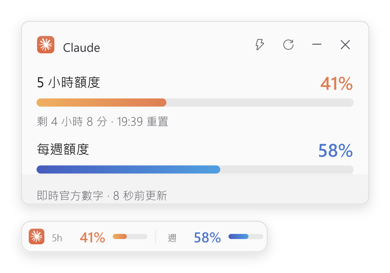

# ClaudeQuota



ClaudeQuota 是一個 Windows 系統列工具，顯示 Claude 訂閱的 5 小時與每週額度用量。

## 功能

- 系統列圖示直接顯示已用百分比，滑鼠停留可看摘要
- 置頂卡片顯示兩個額度的用量、進度條與重置時間，可拖曳定位
- 卡片可縮成一條細橫條，或收起只留系統列圖示
- 卡片與橫條不受「顯示桌面」（Win+D）或切換虛擬桌面影響；全螢幕的遊戲或影片則會自動讓開，結束後自己回來
- 數值取自 Anthropic 官方端點，約每 2 分鐘更新；無法取得時改讀 Claude 桌面版的本機快取
- 可手動或在額度重置後自動開啟新的 5 小時視窗

## 要求

- Windows 10 或更高版本
- Python 3.9 以上
- `pystray`、`pillow`
- 已登入的 Claude Code
- Claude 桌面版（選用，作為備援資料來源）

## 執行

```bash
git clone https://github.com/mintguesss/ClaudeQuota.git
cd ClaudeQuota
pip install pystray pillow
```

雙擊 `啟動.vbs` 啟動，不會出現主控台視窗。

開機自動啟動：按 `Win + R`，輸入 `shell:startup`，將 `啟動.vbs` 的捷徑放入該資料夾。

系統列圖示按左鍵開關卡片，按右鍵可重新整理、切換圖示樣式或結束程式。
卡片右上角的 ✕ 只是收起卡片，程式仍在系統列執行。

## 資料與隱私

- **Claude Code**：讀取本機憑證中的 OAuth token，用於查詢自己帳號的用量；另讀取對話紀錄的
  時間戳以推算額度視窗起點，不讀取對話內容。token 過期時（例如只用桌面版、沒開 CLI）
  會以 refresh token 向官方換發新 token 並寫回同一個憑證檔，與 Claude Code 自己的做法相同。
- **Claude 桌面版**：讀取其本機快取的額度紀錄（由官方用戶端自伺服器取得並保存）。

對外連線僅有兩項，皆為 Anthropic 官方端點：以使用者自己的 token 查詢用量，以及 token 過期時的換發。
不上傳帳號、對話、token 或用量資料，亦無遙測。兩個來源皆無法取得時顯示
「讀不到額度資料」，不進行任何推估。

## 說明

本專案為非官方個人專案，與 Anthropic 無隸屬或背書關係。Claude、Anthropic 及相關標誌
為其各自權利人的商標；MIT 授權不授予任何商標權。所用官方端點無公開文件，可能隨時變更。

介面構想參考自 [GlassQuota](https://github.com/chen10191200-hue/GlassQuota)。

## License

MIT
