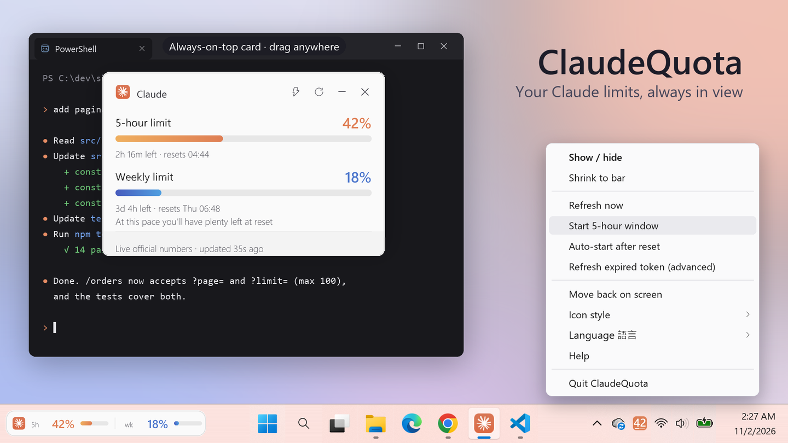
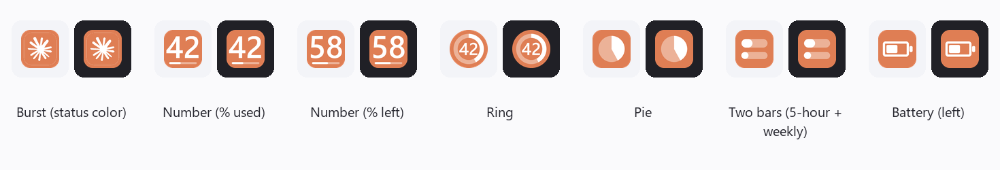
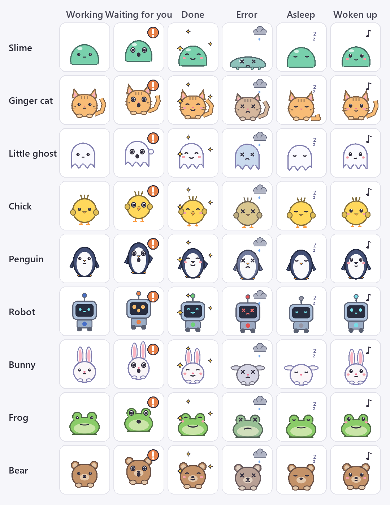
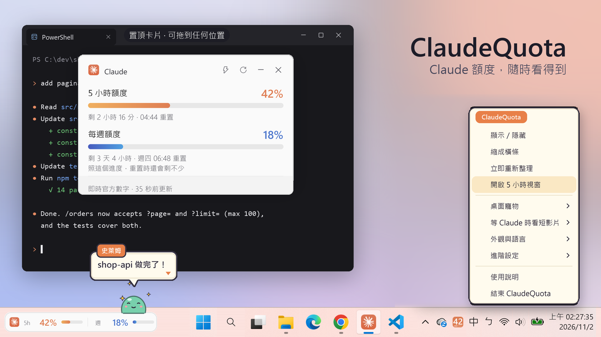
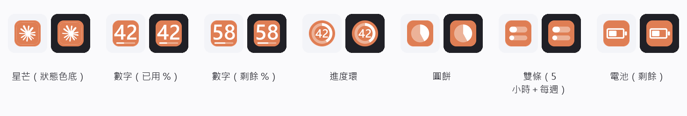
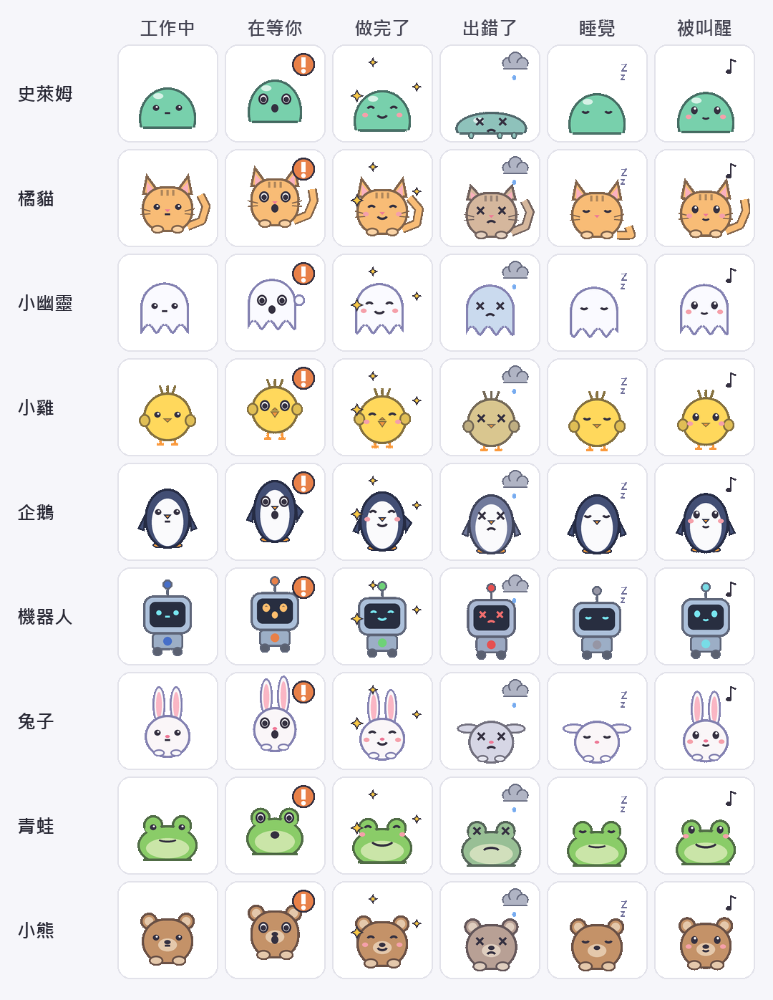

# ClaudeQuota

[](https://github.com/mintguesss/ClaudeQuota/actions/workflows/ci.yml)
[](https://github.com/mintguesss/ClaudeQuota/releases/latest)
[](LICENSE)


**See your Claude subscription's 5-hour and weekly limits at a glance, without opening anything.**

A small Windows tray app for Claude Pro / Max users. It shows the official usage numbers and when the 5-hour window resets, so you stop getting surprised by "you've hit your limit" in the middle of a task.

[中文說明](#中文說明)



## Features

- **Tray icon** with your 5-hour usage in 6 styles; hover for a summary
- **Floating card** with both limits, progress bars, and when each one resets (time left and the exact time, including the weekly reset day)
- **Weekly pace**: at this week's average rate, will you last until the reset? If not, it says in red roughly when you'll run out
- **Mini bar** you can dock on the taskbar, or hide everything and keep only the tray icon
- **Desktop pet** that reacts to Claude Code: bounces while it works, pops a "!" when Claude needs your permission, celebrates when it's done, and naps when nothing's running. Nine characters, seven colors, or your own images ([more below](#desktop-pet))
- **Put them anywhere**: drag the card and the mini bar wherever you like. Each remembers its own spot and reopens there next time
- Stays put through Win+D and virtual desktop switches, and **gets out of the way of full-screen games and videos**
- **Official numbers only**: read from Anthropic's usage endpoint about every 2 minutes, falling back to the Claude desktop app's local cache. If neither is available it says so instead of guessing
- English and Chinese interface, following your Windows language (switchable in the tray menu)
- **Themed menus**: the right-click menus, dialogs and the pet's speech bubble share one look, in four themes (game paper, night, sakura, mint), or your own ([custom themes](docs/custom-pets.md#custom-themes))

## Download

Grab **`ClaudeQuota.exe`** from the [latest release](https://github.com/mintguesss/ClaudeQuota/releases/latest) and run it. No Python needed.

- The exe is built by GitHub Actions from this repository's source; a SHA-256 checksum is attached to each release.
- It is not code-signed, so Windows SmartScreen may warn on first run: **More info → Run anyway**.
- To start with Windows: press `Win + R`, type `shell:startup`, and put a shortcut to `ClaudeQuota.exe` in that folder.

**Requirements:** Windows 10 or 11, and [Claude Code](https://claude.com/claude-code) signed in at least once (that is where the usage token comes from). The Claude desktop app is optional and acts as a fallback.

The numbers are for the account Claude Code is signed in to (the CLI and the VS Code extension share it). If the desktop app is signed in to a different account, ClaudeQuota still shows Claude Code's.

### Run from source

```bash
git clone https://github.com/mintguesss/ClaudeQuota.git
cd ClaudeQuota
pip install pystray pillow
pythonw widget.py
```

`啟動.vbs` (double-click) does the same without a console window.

## Using it

Left-click the tray icon to show or hide the card; right-click for the menu. The ✕ on the card only hides it; quit from the tray menu. **Help** in the tray menu explains every button and menu item in the app itself.

| Card button | What it does |
| --- | --- |
| ⚡ | Start the 5-hour window now (sends one tiny Claude Code request) |
| ↻ | Re-read the numbers (the endpoint is rate-limited, about once every 2 minutes) |
| ─ | Shrink to the mini bar |
| ✕ | Hide (keeps running in the tray) |

### Icon styles

Pick one under **Icon style** in the tray menu. The colour follows your 5-hour usage and turns red as you near the limit.



### Desktop pet

A little creature that shows what Claude Code is up to, so you can look away while it works and still know when it needs you. It reads Claude Code's session logs (only the type and time of each entry, never the content), so it sees the CLI, the VS Code extension and the desktop app's Code tab with no setup.



- **Click it** and a game-style dialog says which project is doing what; click the dialog to close it. It also speaks up on its own when Claude is waiting, done, or hits an error.
- **Asleep?** Click it to wake it up for a while.
- **Right-click the pet** to wake it up any time, set its state by hand (back to automatic whenever you like), toggle its music, resize it or hide it.
- **Drag it** anywhere, in any mode. Off the mini bar it stays where you drop it; on the taskbar walk it carries on from there.
- **Desktop pet** in the tray menu: character, color (each character remembers its own), and where it lives (on the mini bar, walking along the top of the taskbar, walking inside the taskbar, or anywhere).
- **Your own character**: *Character → Custom character…* opens a folder. Make a subfolder with your images named after the states (`working.png`, `waiting.gif`, `done_1.png`, `done_2.png`, …); a single image is enough, animated GIFs play, and missing states fall back to `idle`. For smooth video-like animation, add a `pet.json` with `{"fps": 24}`. To make one from your own video clips and photos (background removed, music lined up), see [Custom pets](docs/custom-pets.md) and `tools/make_pet.py`.
- **Music**: a custom character can come with a WAV that plays while it dances (`"music": {"file": "dance.wav", "states": ["done", "awake"]}` in `pet.json`); *Play music while dancing* turns it off.
- **Watch something while you wait**: *Watch videos while Claude works* opens YouTube Shorts, Instagram Reels, TikTok, YouTube, Netflix, Disney+, Twitch, Bilibili or Facebook Reels, plus any site or app link you add (`spotify:` works too). For the next two hours, when Claude needs your permission, finishes, or hits an error, you get a Windows notification, even if the video is full screen.
- **Waiting for permission** is a guess by default: a tool call that needs approval with no result for 20 seconds. Long-running commands can fool it. *Pet: detect permission prompts exactly* under **Advanced** adds a Claude Code `Notification` hook to `~/.claude/settings.json` that makes it exact; it asks first, keeps a backup, and removing it takes out only that one entry.

### Two optional settings (off by default)

| Setting | What it does | Cost |
| --- | --- | --- |
| **Auto-start after reset** | Starts a new 5-hour window as soon as the last one ends, so your reset time comes earlier | Under **1% of the 5-hour limit** each time (one `claude -p hi` on Haiku, measured on a Pro plan) |
| **Refresh expired token** | Keeps live numbers working when Claude Code hasn't run for a while | May make a running Claude Code ask you to sign in again. Off, you just see the desktop app's cache until you open Claude Code |

The app explains each one and asks before turning it on.

## Data and privacy

- **Claude Code:** reads the OAuth token from `~/.claude/.credentials.json` to ask for *your own* account's usage. It also reads timestamps (not content) from Claude Code's session logs to work out when the window started. With *Refresh expired token* on, it also writes the renewed token back to the same file.
- **Claude desktop app:** reads its locally cached usage history.
- **Network:** only Anthropic's endpoints, for the usage request and, if enabled, the token refresh. No accounts, conversations, tokens or usage data are sent anywhere else. No telemetry.
- **Settings** are stored in `%APPDATA%\ClaudeQuota` (exe) or next to `widget.py` (source).

## Disclaimer

Unofficial personal project, not affiliated with, endorsed by or sponsored by Anthropic. Claude and Anthropic are trademarks of their respective owners; the MIT license grants no trademark rights. The usage endpoint is undocumented and may change at any time.

Interface idea inspired by [GlassQuota](https://github.com/chen10191200-hue/GlassQuota).

## License

[MIT](LICENSE)

---

## 中文說明

**不用打開任何東西，就能隨時看到 Claude 訂閱的 5 小時與每週額度。**

給 Claude Pro / Max 使用者的 Windows 系統列小工具，顯示官方用量數字與 5 小時視窗的重置時間，不會再做到一半才突然撞到額度上限。



### 功能

- 系統列圖示顯示 5 小時用量，有 6 種樣式可選；滑鼠停留可看摘要
- 置頂卡片顯示兩個額度的用量、進度條，以及各自的重置時間（剩多久與確切時間，每週額度會標星期幾）
- **每週進度提示**：照這週的平均速度，重置前夠不夠用；不夠的話用紅字標出大約何時用完
- 卡片可縮成一條細橫條放在工作列上，或收起只留系統列圖示
- **桌面寵物**：跟著 Claude Code 的狀態變表情。工作時蹦蹦跳、需要你允許時冒驚嘆號、做完開心冒星星、沒事就睡覺。九種角色、七種顏色，也能放自己的圖
- **位置隨你放**：卡片和橫條都能拖到任何地方，各自記住位置，下次開啟會出現在同一個地方
- 不受「顯示桌面」（Win+D）或切換虛擬桌面影響；全螢幕的遊戲或影片會自動讓開，結束後自己回來
- **只用官方數字**：約每 2 分鐘向 Anthropic 用量端點取得，取不到時改讀 Claude 桌面版的本機快取；兩者都沒有就明說讀不到，不做推估
- 中英文介面，跟隨 Windows 語言（可在系統列選單切換）
- **主題**：右鍵選單、確認視窗和寵物對話框同一套外觀，有遊戲紙、夜晚、櫻花、薄荷四種，也能自己做（[自訂主題](docs/custom-pets.md#自訂主題)）

### 下載

到 [最新版本](https://github.com/mintguesss/ClaudeQuota/releases/latest) 下載 **`ClaudeQuota.exe`** 直接執行，不需要 Python。

- exe 由 GitHub Actions 從本倉庫原始碼建置，每個版本都附 SHA-256 校驗碼。
- 沒有程式碼簽章，第一次執行時 SmartScreen 可能會擋：按「**其他資訊 → 仍要執行**」。
- 開機自動啟動：按 `Win + R`，輸入 `shell:startup`，把 `ClaudeQuota.exe` 的捷徑放進去。

**需求：** Windows 10 或 11，以及至少登入過一次的 [Claude Code](https://claude.com/claude-code)（用量 token 從它來）。Claude 桌面版為選用，作為備援資料來源。

顯示的是 Claude Code 登入的帳號（CLI 和 VS Code 擴充功能共用同一個）。桌面版登入別的帳號時，仍以 Claude Code 的為準。

從原始碼執行：`pip install pystray pillow` 後雙擊 `啟動.vbs`（不會出現主控台視窗）。

### 圖示樣式

在系統列選單的「**圖示樣式**」切換。顏色跟著 5 小時用量走，快用完時會變紅。



### 桌面寵物

讓你在 Claude 跑的時候可以去做別的事，看一眼就知道它是不是在等你。它讀 Claude Code 的對話紀錄（只看每一筆的種類和時間，不讀內容），所以 CLI、VS Code 擴充功能、桌面版的 Code 分頁都抓得到，不用設定。



- **點一下**會跳出遊戲風對話框，說明哪個專案在做什麼；再點對話框就關掉。在等你、做完、出錯時也會自己冒出來講。
- **睡著了？** 點它一下就會醒來陪你一陣子。
- **在寵物身上按右鍵**：隨時叫醒、手動改變狀態（隨時可以設回自動）、音樂開關、調大小、隱藏。
- **可以拖**，哪種模式都行：從橫條上拖下來就停在你放的地方；散步模式會從放下的地方繼續走。
- 系統列選單的「**桌面寵物**」可以換角色、顏色（每個角色各記各的）和位置（坐在迷你橫條上、在工作列上方散步、在工作列裡散步、自由擺放）。
- **自訂角色**：「角色 → 自訂角色…」會打開一個資料夾。開個子資料夾放你的圖，用狀態命名（`working.png`、`waiting.gif`、`done_1.png`、`done_2.png`…）。一張圖就能用，GIF 會動，缺的狀態會改用 `idle` 的圖。想要像影片一樣順，再放一個 `pet.json` 寫 `{"fps": 24}`。想用自己的影片和照片做（自動去背、音樂對齊），看 [自訂寵物](docs/custom-pets.md#自訂寵物) 和 `tools/make_pet.py`。
- **音樂**：自訂角色可以附一個 WAV，跳舞時播放（在 `pet.json` 寫 `"music": {"file": "dance.wav", "states": ["done", "awake"]}`）；「跳舞時播音樂」可以關掉。
- **等的時候看影片**：「等 Claude 時看短影片」可以打開 YouTube Shorts、Instagram Reels、TikTok、YouTube、Netflix、Disney+、Twitch、Bilibili、Facebook Reels，也能加你自己常用的網站或 app 連結（例如 `spotify:`）。之後兩小時內 Claude 需要你允許、做完或出錯，會發 Windows 通知叫你，影片全螢幕也看得到。
- 「**在等你允許**」預設是用猜的：需要允許的工具送出 20 秒還沒結果就當作在等你，跑很久的指令會猜錯。「進階設定」裡可以裝 Claude Code 的 `Notification` hook 讓它變準：會先說明並詢問、改之前留備份，移除時只拿掉那一條。

### 兩個選用設定（預設關閉）

| 設定 | 作用 | 代價 |
| --- | --- | --- |
| **重置後自動起算** | 上一個 5 小時視窗一結束就開新的，重置時間會提早 | 每次花**不到 5 小時額度的 1%**（用 Haiku 跑一次 `claude -p hi`，在 Pro 方案實測） |
| **自動換發過期 token** | Claude Code 很久沒開時也能看到即時數字 | 正在執行的 Claude Code 可能會要你重新登入。不開的話只會改顯示桌面版快取，開一次 Claude Code 就恢復 |

開啟前程式會先說明並詢問；系統列選單的「**使用說明**」也會逐項解釋每個按鈕和功能。

### 資料與隱私

- **Claude Code**：讀取 `~/.claude/.credentials.json` 的 OAuth token，只查詢自己帳號的用量；另讀取對話紀錄的時間戳（不讀內容）推算視窗起點。開啟「自動換發過期 token」時，會把新 token 寫回同一個檔案。
- **Claude 桌面版**：讀取其本機快取的用量紀錄。
- **網路**：只連 Anthropic 官方端點（查詢用量，以及開啟時的 token 換發）。不上傳帳號、對話、token 或用量資料，沒有遙測。
- **設定檔**存在 `%APPDATA%\ClaudeQuota`（exe）或 `widget.py` 旁邊（原始碼）。

### 說明

本專案為非官方個人專案，與 Anthropic 無隸屬或背書關係。Claude、Anthropic 及相關標誌為其各自權利人的商標；MIT 授權不授予任何商標權。所用官方端點無公開文件，可能隨時變更。介面構想參考自 [GlassQuota](https://github.com/chen10191200-hue/GlassQuota)。
